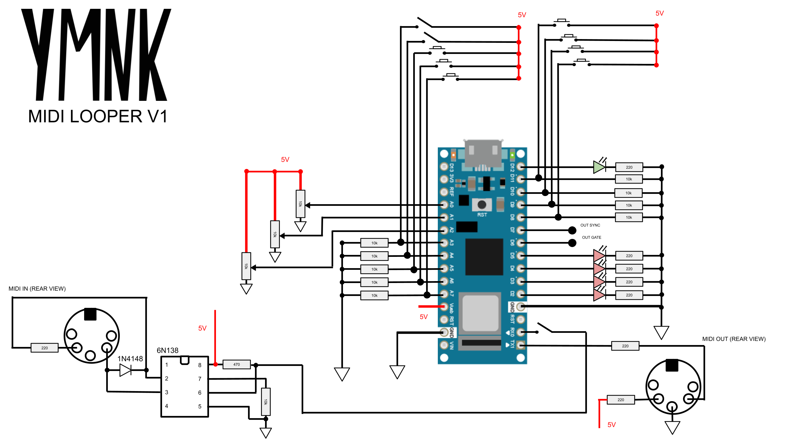

# midiLoop
A nice MIDI looper/sequencer made with Arduino

This project use uClock by midilab : https://github.com/midilab/uClock
Use the version uClock 1.5 ! Otherwise the code won't compile.

Up to date circuit :

